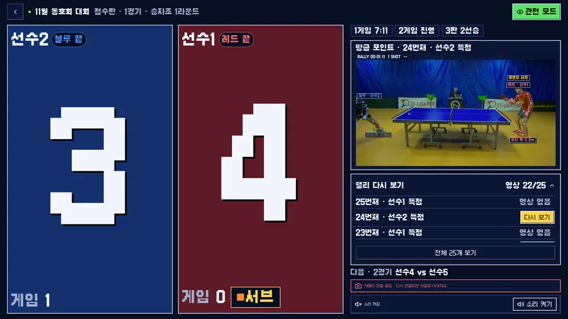
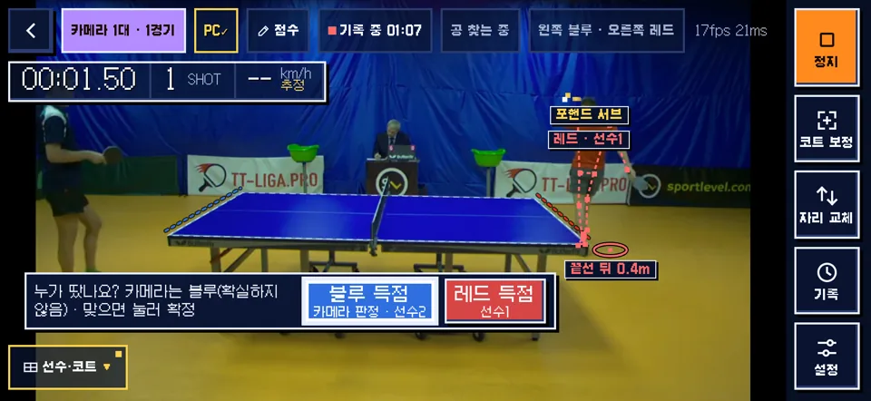
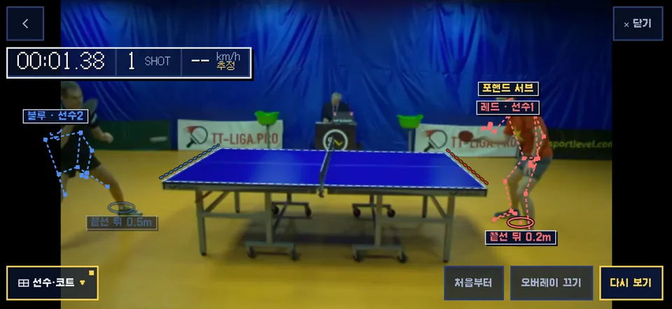
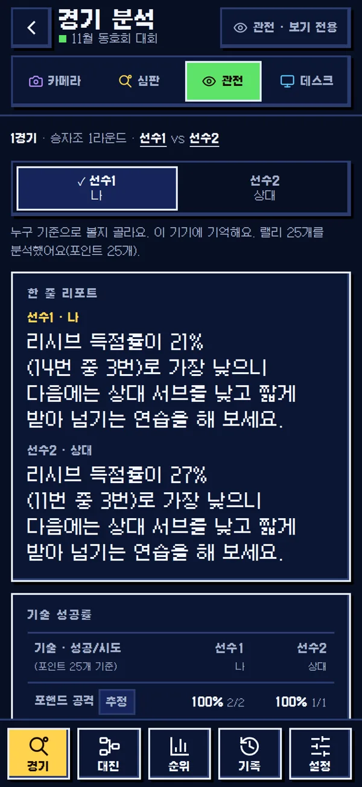
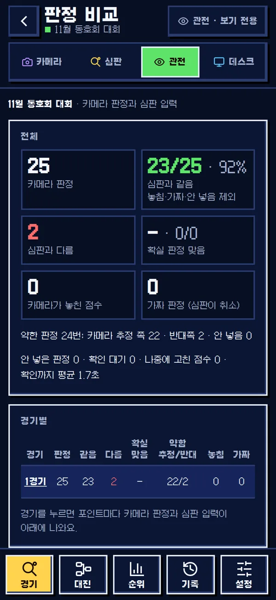
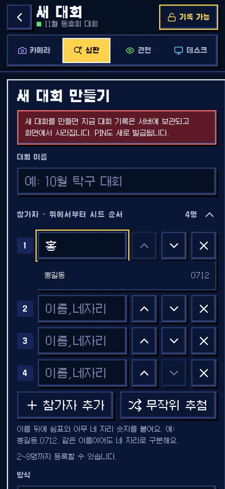
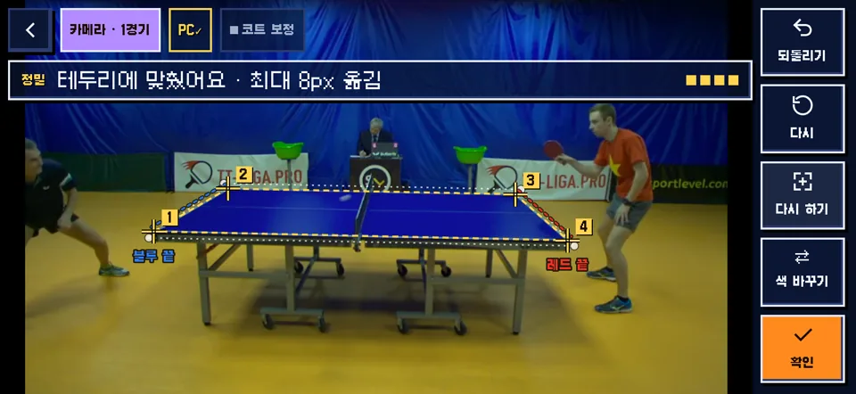

<div align="center">

**English** · [한국어](README.ko.md)

<h1>
  
  
</h1>


<sub>This animation and the screenshots: frames of <code>test_2</code> from the <a href="https://lab.osai.ai/">OpenTTGames dataset</a> (OSAI), cropped and scaled, with the app's overlay drawn on top. These images are licensed under <a href="https://creativecommons.org/licenses/by-nc-sa/4.0/">CC BY-NC-SA 4.0</a>, not under the MIT license of the code.</sub>

**Free, open-source table tennis (ping-pong) video analysis from one phone camera. It runs in the browser on your phone, and you host it yourself.**

[](LICENSE)
[](https://github.com/orientpine/pingpong-vision/releases)
[](https://bun.sh)
[](#install-on-your-pc-with-tailscale)
[](LICENSE)

</div>

PingPong Vision is a **table tennis analysis web app** (a PWA) for **iPhone Safari** and other mobile browsers. Put the phone on a tripod beside the table and it shows, live on the picture:

- **pose estimation** (skeletons for two players, MediaPipe Pose Landmarker)
- **ball tracking** (colour and motion, no ML)
- **rally time**, **shot count** and an **estimated shot speed** in km/h
- a **bounce map** and each player's **standing position**

All the computer vision runs on the phone. The camera stream never leaves it unless you turn on saving rally clips to your own PC. You run the small server on your own computer with [bun](https://bun.sh) and open it on your phone over HTTPS through [Tailscale](https://tailscale.com). There is no account, no subscription, and no cloud service of ours.

## Contents

- [What's new in 1.1](#whats-new-in-11)
- [Features](#features)
- [Screenshots](#screenshots)
- [Quick start (try it on your computer)](#quick-start-try-it-on-your-computer)
- [Install on your PC with Tailscale](#install-on-your-pc-with-tailscale)
- [Tournament and PIN](#tournament-and-pin)
- [Using it at the table](#using-it-at-the-table)
- [Accuracy and limits](#accuracy-and-limits)
- [Optional extras](#optional-extras)
- [Adapting to another sport](#adapting-to-another-sport)
- [Contributing](#contributing)
- [Releases](#releases)
- [License and third-party notices](#license-and-third-party-notices)

## What's new in 1.1

**PingPong Vision now runs a whole tournament.** One PC, one address: referees keep score on their phones, the tripod phone calls the points, and the TV shows the board. Everything below is in the public repository up to 1.1.35; the screens are the real app on a public test clip, with made-up player names.

| | |
|---|---|
|  | **Run the tournament.** Double, triple or league brackets for 2 to 8 players. Referee phones, spectator screens and a big TV scoreboard stay in sync, and a PIN protects the score ([Tournament and PIN](#tournament-and-pin)). |
|  | **The camera calls the point.** It judges each point from the bounces. Its call waits on the *Who won it?* bar with that side already chosen, and one tap enters it, on the camera or on the referee screen, with 3 s to cancel. A call it is not sure of is shown in words and left to you. |
| | **Two phones, one match.** A second phone with the PIN joins by itself: the two merge their bounces, one fills in the moments the other lost the ball, and each point still counts once. Each phone's end colour (blue or red) is picked by a person after the corners, so the two agree. |
|  | **Replays with the overlay.** Each point's clip is saved on your PC as original video, holding the 3 s before the rally; the replay starts 1 s before the serve and plays full screen on the phone. Names, skeletons and the ball trail are drawn when you watch and fold away with one tap. |
|  | **Match analysis sheet.** After the match: a one-line report, technique success rates, rally lengths, serve and receive points, and where each shot landed. Forehand / backhand and the stroke kinds are **estimates** ([Accuracy and limits](#accuracy-and-limits)). |
|  | **Camera calls vs referee.** Every camera call is kept next to what the referee entered: how often they matched, which side the referee picked on weak calls, missed and cancelled calls, per match and as CSV. Numbers only, no names or pictures. |
|  | **Player name + 4 digits.** Enter each player as `name,1234` once (for example `홍길동,0712`). The digits only tell apart players with the same name and are not shown to spectators, and that player's matches stay together across tournaments. |
|  | **Precise calibration, and a placement guide.** Tap the four corners roughly, press **Precise**, and the app fits them to the table's white border; your taps stay faint for comparison (**Revert**, **Fit again**). An optional guide in Settings checks position, height, framing, level and shake before you confirm. |

Runs on Linux, macOS and Windows: `bun run.mjs` serves both apps on one address, `bun update.mjs` updates, and Settings shows a line when a newer release exists. Every screen comes in **English** or **한국어**. Free, MIT, no account.

<sub>The camera, replay and calibration images and the TV's clip are frames of the OpenTTGames dataset (OSAI, <code>test_2</code>) with the app's overlay drawn on top, CC BY-NC-SA 4.0, not MIT. The scoreboard, sheet, comparison and form images contain no dataset frames. Player names are made up.</sub>

## Features

| | What you get |
|---|---|
| 🏓 **Live overlay** | Rally timer, shot count, estimated speed, shot type (drive / smash / lob / push, forehand / backhand by rule), ball trail with a **LOCK** box when the ball track is trusted |
| 🧍 **Players** | Skeletons for the player at each end, MOVE distance, wrist angle, standing position behind or beside the table |
| 🗺️ **Court map** | Bounces and standing positions on a top view of the table |
| 📐 **One-time calibration** | Tap the four table corners roughly, press Precise to fit them to the white border, and confirm the outline |
| 🌐 **English or Korean** | Pick **English** or **한국어** on the first screen (mode choice) or in **Settings**. Every screen, the overlay on the video, score call-outs and error messages follow it, and the phone remembers it. Player names stay as typed |
| 📱 **Phone first** | Portrait or landscape, full-screen picture with floating panels. Works on a tablet or a TV (AirPlay mirroring) as a big-screen layout |
| 🎞️ **Rally history and replays** | Each rally's time, shots, top speed and bounce map. Clips can be saved to *your* PC with an unguessable share link (optional) |
| 🛟 **Stable judging mode** | If the phone falls behind (repeated frames or under 12 reads per second), the picture shrinks so the analysis keeps up, then comes back |
| 🔒 **Private by design** | On-device analysis, the server binds to `127.0.0.1` only, nothing is uploaded unless you turn it on |
| 🏆 **Tournaments** | Double, triple and league brackets for 2 to 8 players, with referee, camera, spectator and TV screens on one address, and a PIN for scoring ([Tournament and PIN](#tournament-and-pin)) |
| 🧪 **Measurable** | Offline harness that scores ball, bounce and shot detection against the public [OpenTTGames](https://lab.osai.ai/) annotations |

## Screenshots

All screenshots are the real app computing on a clip from the public OpenTTGames dataset. They are not mock-ups.

| Portrait phone | Calibration (4 taps, snapped to the border) | Rally history |
|---|---|---|
|  |  |  |


*Frames from the OpenTTGames dataset by OSAI (https://lab.osai.ai/), CC BY-NC-SA 4.0, changed: cropped, scaled, app overlay added. The images in `docs/img/` are under [CC BY-NC-SA 4.0](https://creativecommons.org/licenses/by-nc-sa/4.0/), not MIT. The dataset itself is not included in this repository.*

## Quick start (try it on your computer)

You need [bun](https://bun.sh) 1.1 or newer, `git`, `curl` and `unzip`.

```bash
git clone https://github.com/orientpine/pingpong-vision && cd pingpong-vision
bash install.sh && bun run.mjs     # Windows: install.ps1, see step 3
```

Open **http://localhost:8780/** for the tournament app, or **http://localhost:8780/vision/** for the camera (keep the trailing slash). Desktop browsers treat `localhost` as secure, so the camera works there. No camera? Tap **영상 파일로 시험** (*Test with a video file*) and pick any table tennis video.

`install.sh` checks your tools, runs `bun install`, downloads the pose models (sha256-checked) into `public/models/`, writes your settings file and does a test run (`/healthz` must answer 200). It is safe to run again. `bun test` runs the unit tests.

## Install on your PC with Tailscale

This is how the maintainer runs it at the club: the server stays on a PC at home or at the venue, and phones open it over HTTPS. A phone only allows camera access on HTTPS, and Tailscale gives your PC an HTTPS address with a real certificate, for free and without opening any port on your router.

```text
 phone (Safari/Chrome) ──HTTPS──▶ Tailscale ──▶ your PC: tailscale serve ──▶ bun server.js (vision 127.0.0.1:8791, tournament 127.0.0.1:8792)
```

**What you need**

- A PC that stays on: Linux, macOS, or Windows 10/11
- A phone: iPhone with Safari (the maintainer uses iOS 18) or Android with Chrome
- A free Tailscale account (sign in with Google, Microsoft, GitHub or Apple)
- A tripod or phone stand, about 1.5 to 2 m high

### 1. Tailscale on the PC and the phone

1. Install Tailscale on the PC: https://tailscale.com/download (on Linux: `curl -fsSL https://tailscale.com/install.sh | sh`, then `sudo tailscale up`).
2. Install the Tailscale app on the phone (App Store or Google Play) and sign in with **the same account**.
3. In the [admin console → DNS](https://login.tailscale.com/admin/dns), turn on **MagicDNS** and **HTTPS Certificates**. `tailscale serve` will also ask for this the first time.
4. On Linux, let your user run `tailscale serve` without sudo (once):

   ```bash
   sudo tailscale set --operator=$USER
   ```

**macOS and Windows:** install the Tailscale app from the same download page and sign in. Its `tailscale` command works in Terminal (macOS) and PowerShell (Windows).

### 2. bun

```bash
curl -fsSL https://bun.sh/install | bash
```

**Windows (PowerShell):** `powershell -c "irm bun.sh/install.ps1 | iex"`, and git with `winget install --id Git.Git -e`.

Open a new terminal afterwards so `bun` is on your `PATH` (`bun --version` should print 1.1 or newer). On Linux you may need `sudo apt install -y git curl unzip` first. macOS has git after `xcode-select --install`.

### 3. Get the code and install

```bash
git clone https://github.com/orientpine/pingpong-vision
cd pingpong-vision
bash install.sh
```

On **Windows**, run the installer in PowerShell instead of `bash install.sh`:

```powershell
powershell -ExecutionPolicy Bypass -File install.ps1
```

The last lines tell you what to do next. A good run ends with `/healthz 200` (Linux, macOS) or `/ and /vision/ answer 200` (Windows).

### 4. Settings

`install.sh` created `~/.config/pingpong-vision/deploy.env` from [`deploy.env.example`](deploy.env.example):

```bash
PORT=8791                # local port; the server listens on 127.0.0.1 only
FUNNEL_PORT=443          # HTTPS port on your Tailscale name (443 = no port in the address)
PPV_TS_MODE=serve        # serve: only your tailnet's devices; funnel: anyone with the link
TOURNAMENT_PORT=8792     # local port of the tournament app
PPV_TOURNAMENT_URL=http://127.0.0.1:8792   # where the camera app finds it; off runs the camera alone
```

Keep `serve`: only devices signed in to your tailnet can open the app. To let phones without Tailscale in, see [Open it to the internet](#open-it-to-the-internet-optional).

#### Open it to the internet (optional)

**Risk: anyone who learns the address can open it.** They can watch, and with the tournament app they can try to guess the 4-digit PIN, or create the first tournament before you do. Turn it on only when you need it.

1. In the Tailscale [admin console](https://login.tailscale.com/admin/acls), allow Funnel for this PC (`tailscale funnel` prints the link the first time).
2. In `deploy.env` set `PPV_TS_MODE=funnel` and a `FUNNEL_PORT` of 443, 8443 or 10000.
3. Linux with `start.sh`: run `./start.sh --restart`. To go back, set `PPV_TS_MODE=serve` and run it again.
4. macOS, Windows (`bun run.mjs`): share with `tailscale funnel --bg --https=443 http://127.0.0.1:8780` instead of the `serve` line. To go back: `tailscale funnel --https=443 off`, then the `serve` line again.

### 5. Start it

**Linux (systemd):** one command. It starts a user service that restarts on failure and on boot, waits for `/healthz`, and sets up `tailscale serve` (or funnel):

```bash
./start.sh
loginctl enable-linger $USER   # keep it running when you are logged out (once)
```

It starts the tournament app too and prints `URL: https://<your PC's MagicDNS name>:443/` (the full name `tailscale serve status` shows). `./start.sh --restart` deploys the current checkout and restarts. The camera service runs a copy under `~/.local/share/pingpong-vision/releases/`, so editing the checkout changes nothing until you restart. If the analysis desk worker is running, it restarts onto the new release too (`systemctl --user restart pingpong-desk-worker` by hand).

**macOS, Windows, or Linux without systemd:** one command starts both apps on one local address (`127.0.0.1:8780`). Keep the window open; Ctrl+C stops it. Then share that address once with Tailscale. The `--bg` setting is remembered across reboots.

```bash
bun run.mjs                                              # terminal 1 (keep open)
tailscale serve --bg --https=443 http://127.0.0.1:8780   # terminal 2, once
tailscale serve status                                   # shows your https:// address
```

On Windows type the same lines in PowerShell. `run.mjs` restarts an app that stops, and passes each phone's address on to the apps, so a wrong PIN on one phone locks only that phone.

### 6. Open it on the phone

1. Make sure Tailscale is **connected** on the phone.
2. Open `https://<your PC's MagicDNS name>/` (the address from step 5) and pick a role ([Tournament and PIN](#tournament-and-pin)). `/vision/` opens the camera directly.
3. The first visit downloads about 20 MB (pose model and runtime). The loading bar counts the real bytes, and later visits use the cache.
4. Add it to the home screen so it opens full screen like an app: **Safari** → Share → *Add to Home Screen*. **Chrome** → ⋮ → *Add to Home screen* / *Install app*.
5. Tap **카메라 시작** (*Start camera*) and allow the camera.

### 7. Start automatically (macOS, Windows)

`start.sh` covers Linux.

**macOS:** a LaunchAgent keeps `bun run.mjs` running and starts it when you log in. Save this as `~/Library/LaunchAgents/local.pingpong-vision.plist` (change `YOU` in both paths):

```xml
<?xml version="1.0" encoding="UTF-8"?>
<!DOCTYPE plist PUBLIC "-//Apple//DTD PLIST 1.0//EN" "http://www.apple.com/DTDs/PropertyList-1.0.dtd">
<plist version="1.0"><dict>
  <key>Label</key><string>local.pingpong-vision</string>
  <key>ProgramArguments</key><array><string>/Users/YOU/.bun/bin/bun</string><string>/Users/YOU/pingpong-vision/run.mjs</string></array>
  <key>RunAtLoad</key><true/>
  <key>KeepAlive</key><true/>
</dict></plist>
```

```bash
launchctl load -w ~/Library/LaunchAgents/local.pingpong-vision.plist
```

**Windows:** run the installer once more with `-AutoStart`. It adds a Task Scheduler task, *PingPong Vision*, that runs `bun run.mjs` when you sign in:

```powershell
powershell -ExecutionPolicy Bypass -File install.ps1 -AutoStart
```

To remove it: `Unregister-ScheduledTask 'PingPong Vision'`.

### 8. Update

One command updates it, on Linux, macOS and Windows alike:

```bash
cd pingpong-vision && bun update.mjs
```

It goes step by step and says what it does:

1. **Checks this copy.** If you changed files in the folder or made commits of your own, it stops and changes nothing (it lists the files).
2. **Backs up** your settings folder (`~/.config/pingpong-vision`), the tournament data and the rally saves into `~/pingpong-vision-backups/<date>_<time>/`.
3. **Gets the new version** (`git pull`) and runs `install.sh` again (`install.ps1` on Windows).
4. **Restarts the app** the way it runs: the Linux service (`start.sh --restart`) or the macOS LaunchAgent from step 7. If you started it by hand, it waits for you to stop it and start it again.
5. **Checks** that `/healthz` answers and the new version is running.

If a step after the backup fails, it prints the lines that take you back to the version you had. Type the whole name: `bun update` without `.mjs` is bun's own package updater.

Coming from v1.0.x, which has no `update.mjs` yet: run `git pull && bash install.sh` and restart once as before; from then on `bun update.mjs`.

**New version line.** When the public repository has a newer release, Settings (on the camera screen and on the tournament screen) shows one line, *New version · vX.Y.Z*, that opens its release notes. To know that, the app asks GitHub's public API for the latest release at most once a day and sends nothing else; when it cannot reach GitHub it shows nothing. To turn it off, add `PPV_UPDATE_CHECK=off` to `deploy.env` and restart.

See [Releases](https://github.com/orientpine/pingpong-vision/releases) for what changed.

### 9. Troubleshooting

| Problem | Fix |
|---|---|
| The camera button does nothing or says permission denied | The page must be `https://` (or `localhost`). On iPhone: Settings → Safari → Camera → *Ask* or *Allow*, then reload. Close other apps using the camera. |
| `http://<PC's LAN IP>:8791` does not open | By design: the server only listens on `127.0.0.1`. Use the Tailscale `https://` address. |
| The Tailscale `https://` address does not load on the phone | Tailscale must be connected on the phone with the same account. Run `tailscale serve status` on the PC and check that HTTPS Certificates is on in the admin console. The first certificate can take a minute. |
| `tailscale serve` says *access denied* | Run `sudo tailscale set --operator=$USER` once, or put `sudo` in front. |
| Funnel says it is not enabled | Funnel needs a tailnet policy change: follow the link it prints, or use `PPV_TS_MODE=serve`. |
| Firewall | Nothing to open. Tailscale makes its own connection, and the app needs no inbound port. |
| `install.sh` or `start.sh` says port 8791 is in use | Find it with `ss -ltnp \| grep 8791` (Linux) or `lsof -i :8791` (macOS). Set another `PORT` in `deploy.env`, run `bash install.sh` again, and use the new port in the `tailscale serve` command. |
| `start.sh` stops with *set PPV_TOURNAMENT_URL*, *set FUNNEL_PORT* or *set PPV_TS_MODE* | Your `deploy.env` is missing that line. Copy it from `deploy.env.example`. |
| The loading bar stops | The reason and **다시 받기** (*download again*) appear. Check the PC is online: the models are served by your PC, and the PC downloaded them in `install.sh`. |
| `bun: command not found` | Open a new terminal after installing bun, or run `~/.bun/bin/bun`. |
| The referee screen says the camera is waiting for its PIN | Enter the PIN on the camera phone. Camera and scoreboard must be open on the same address. |
| Service logs (Linux) | `journalctl --user -u pingpong-vision -n 50`, and `-u pingpong-scoreboard` for the tournament app |

## Tournament and PIN

`tournament/` is the scoreboard. It runs beside the camera app on one address: `https://<your PC>/` is the entrance and `/vision/` is the camera. The screens are in Korean, so the button names are given in both languages here.

### Roles

Each device picks its role on the first screen (the name appears on the button, and the top button changes it later):

| Role | Who | Needs the PIN? | What it does |
|---|---|---|---|
| **심판** (*Referee*) | The person keeping score | Yes | Add, undo and fix points. In referee mode, tap the left or right half of the screen for a point; hold to undo |
| **카메라** (*Camera*) | The phone on the tripod | Yes | Films the table and enters points by itself (the same app as above) |
| **관전** (*Spectator*) | Anyone | No | Live score, replays and sound. Nothing can be changed from here |
| **TV** | A big screen or tablet | No | Choose **관전** on it: a big screen gets the large scoreboard layout |

### Make a tournament

1. Open `https://<your PC>/`, choose **심판**, and go to **새 대회 만들기** (*New tournament*).
2. Type a tournament name and 2 to 8 players. Enter each player as `name,four digits` (for example `홍길동,0712`). The digits only tell apart players with the same name and are not shown to spectators; a player you entered once comes up in the list in the next tournament as you type the first letters. Set the seed order or use the random draw.
3. Pick the format: **더블** (double elimination, out after 2 losses), **트리플** (triple, out after 3) or **리그전** (league, everyone plays everyone), and the match length.
4. Tap **대회 만들기** (*Create*). The bracket fills in by itself as matches finish. A new tournament archives the old one under the **기록** (*History*) tab.

### The PIN

The PIN is 4 digits. Referees and cameras need it to write scores; watching needs nothing. There is no PIN until the first tournament exists, so anyone who can open the address could create that first one. Keep `PPV_TS_MODE=serve` (the default), or create it right after installing.

**First install: use the one it gives you, or pick your own**

- Do nothing, and **each new tournament gets a random PIN**. It appears once on screen after **대회 만들기**, and that device remembers it. Open **설정** (*Settings*) on that device to see it again.
- To **pick your own PIN**, write it to a file and restart. Every tournament then uses it. Replace `4827` with your own 4 digits (keep the quotes):

  ```bash
  cd pingpong-vision
  mkdir -p tournament/data
  echo '{"pin": "4827"}' > tournament/data/settings.json
  ./start.sh --restart     # macOS, Windows: Ctrl+C in the bun run.mjs window, then bun run.mjs again
  ```

**Making a new tournament**

- With `settings.json`, the PIN stays the same.
- Without it, you need the current PIN to replace a tournament, and the new one gets a new random PIN. Tell your referees and enter it again on the camera.

**Changing the PIN**

Edit `tournament/data/settings.json` and restart as above. The running tournament switches to the new PIN and keeps its scores. Devices holding the old PIN are asked for the new one the next time they write. Delete the file and restart to go back to random PINs from the next new tournament.

**Forgot it**

On the PC, in the `pingpong-vision` folder:

```bash
grep '"pin"' tournament/data/tournament.json
```

The first match is the current PIN. The file stays on your PC, and `tournament/data/` is never committed.

**Too many wrong tries.** Five wrong PINs lock that device for 1 minute. Twenty wrong PINs within a minute from all devices together pause devices that have not entered the right PIN recently; phones already scoring keep working. Restarting the app clears the locks.

**Keep it safe.** Four digits only slow guessing down, so `serve` is the safer choice. Never commit `tournament/data/`: it holds your players' names, scores and the PIN.

### Connect the camera

`PPV_TOURNAMENT_URL` tells the camera app where the scoreboard is, so it can check the PIN for saving clips to your PC. `install.sh` writes it into `deploy.env`:

```bash
TOURNAMENT_PORT=8792
PPV_TOURNAMENT_URL=http://127.0.0.1:8792   # same port as above, or off to run the camera alone
```

`PPV_TOURNAMENT_DATA` is the file that holds the PIN. `start.sh` sets it to `tournament/data/tournament.json` for you. Set it only if you moved the data with `DATA_DIR`.

Then, on the tripod phone:

1. Open `https://<your PC>/`, choose **카메라**, and enter the PIN once.
2. Tap the four table corners ([Using it at the table](#using-it-at-the-table)).
3. The referee screen shows **카메라 연결됨** (*camera connected*). Points now go in by themselves, with a 3 s cancel bar on the camera.

The camera and the scoreboard must be on the same address. Opening them on different hosts or ports does not link them.

## Using it at the table

1. **Place the phone** on a tripod in line with the net, 2 to 3 m from the side of the table, 1.5 to 2 m high, looking slightly down, so the whole table and both players are in the picture. Keep it level. If the camera sits at table height, the table top becomes a line and bounces and speed cannot be computed. Placement details: [docs/system-design.md](docs/system-design.md).
2. The app opens in Korean. Tap **English** on the mode choice or in **Settings** (설정); the names below are the English ones. Tap **Start camera**, or **Try a video file** to try a recording.
3. **Calibrate once** with **Calibrate**. Tap the four table corners in the order shown: (1) your end, left; (2) your end, right; (3) far end, right; (4) far end, left. Rough taps are fine: press **Precise** and the app fits them to the white border over about a second, showing your taps faintly beside the fit (**Revert**, **Fit again**). Drag a point to fix it, then **OK**. Calibration stays as long as the tripod does not move. Until it is done, or when the four points do not enclose a table top, the app does not look for the ball. It also pauses while the phone shakes.
4. The two ends are **Red side / Blue side**. If the players change ends, tap **Swap**. Set a left-handed player's racket hand in **Settings**. It decides forehand or backhand.
   Enable **Camera placement guide** in Settings when needed (off by default) for skippable position, angle, framing and level/shake checks before Precise; phones without orientation sensors still show placement recommendations.
5. Play. Tap **Stop** when done, and open **History** for each rally's time, shot count, top speed and bounce map.
6. On an iPad in landscape, or a phone mirrored to a TV, the app switches to the big-screen layout. You can pick it in Settings.

## Accuracy and limits

Measured with this release's code on OpenTTGames `test_2` (1080p, 120 fps source, 30 s), processed at 60 fps on a Linux PC with the command below. **This is not a measurement on an iPhone.**

| Metric (`test_2`) | Result |
|---|---|
| Ball recall / precision (within 20 px, on annotated frames, n = 387) | 86.6% / 96.5% |
| Bounce F1 (28 annotated bounces) | 83.3% (precision 96.9% when counting bounces the annotation skips) |
| Bounce intervals with the right shot count | 15 / 16 |

Reproduce it: download `test_2.mp4` and `test_2.zip` from https://lab.osai.ai/datasets/openttgames/data/ into `data/videos/` (gitignored), unzip the markup to `data/videos/test_2/`, then run:

```bash
bun qa/ball-offline.mjs --video=data/videos/test_2.mp4 \
  --corners='[{"x":355,"y":634},{"x":557,"y":519},{"x":1339,"y":535},{"x":1486,"y":659}]' \
  --out=/tmp/test_2.offline.json
bun qa/score.mjs /tmp/test_2.offline.json data/videos/test_2 /tmp/test_2.score.json
```

**Limits** (please read before you rely on the numbers):

- **Speed and distance are estimates from one camera.** Ball height is unknown, so positions are projected onto the table's centre line and scaled by the table length (2.74 m). A side view works best.
- **The ball detector uses colour and motion**, tuned for a white ball (orange is experimental). White clothes, white walls and dark halls cause misses and false hits.
- **Frame rate.** Safari asks for 60 fps and may drop to 30 fps in low light, where a fast ball can skip a bounce. The app warns about low light at calibration.
- **Shot type is a rule**, not a model: forehand or backhand from which side of the body the wrist is on, drive / smash / lob / push from speed and arc. No spin.
- **Two players only**, one at each end. Doubles and people walking past are not handled.
- **The phone's speed varies.** `/vision/bench.html` measures pose speed on your phone. It needs one 1280x720 still with two players at `public/bench/frame.jpg` (not included), for example `ffmpeg -ss 0.9 -i data/videos/test_2.mp4 -frames:v 1 -vf scale=1280:720 -q:v 3 public/bench/frame.jpg`.

## Optional extras

- **Save rallies to your PC.** Each finished rally's record and clip go to `save-server.js` on your PC (the folder is `0700`, with size and count caps). The rally gets a long, unguessable share link and a delete button. A one-time setup link hands the upload key to a phone. See [docs/save-to-pc.md](docs/save-to-pc.md). Never commit the key under `~/.config/pingpong-vision/`.
- **Scoreboard link.** `public/js/point.js` judges who won each point from the bounce order (double bounce, out, miss). `public/js/tournament.js` can enter it into a scoreboard app served at `/` of the same origin, with a 3 s cancel bar, score call-outs in the chosen language (Korean or English) and one-tap let / fault prompts. The scoreboard is in `tournament/` ([Tournament and PIN](#tournament-and-pin)), and [docs/tournament-link.md](docs/tournament-link.md) describes its API. With `PPV_TOURNAMENT_URL=off` the camera works on its own.

Environment variables of `server.js`:

| Variable | Default | What it does |
|---|---|---|
| `PORT` | `8791` | Port, always bound to `127.0.0.1` |
| `PPV_QA` | unset | `1` also serves the `qa/` pages |
| `PPV_SAVE_DIR` | `~/pingpong-vision-saves` | Where saved rallies go |
| `PPV_KEY_FILE` | `~/.config/pingpong-vision/upload-key` | Upload key file (created on first start) |
| `PPV_SETUP_FILE` | `~/.config/pingpong-vision/setup-tokens.json` | One-time setup link tokens |
| `PPV_TOURNAMENT_URL` | unset | Scoreboard app that checks the PIN for PC save. Unset means that feature is off |
| `PPV_TOURNAMENT_DATA` | `tournament/data/tournament.json` | The file holding the tournament PIN |

## Adapting to another sport

Everything specific to table tennis lives in a handful of modules:

| Concern | Where | What to change |
|---|---|---|
| Court geometry | `public/js/geom.js`: `TABLE_LENGTH` (2.74), `TABLE_WIDTH` (1.525), `TABLE_HEIGHT` (0.76), `makeCalibration` | Court size in metres. On a court the players stand on the court plane, so the `TABLE_HEIGHT` floor drop becomes 0 |
| Duplicated constants | `public/js/ui.js`: `TABLE_L`, `TABLE_W`, `MOVE_SCALE_M`, `SHOT_SCALE_KMH` | Bounce-map shape and meter scales |
| Player zone | `public/js/players.js`: `ZONE_M`, `plausiblePerson` | Players can stand far outside a tennis court, so widen the zone |
| Ball appearance | `public/js/ball.js`: `BallDetector`, `BallTracker`, `pathResidual` | Colour, brightness, size and speed gates (a tennis ball is yellow-green and bigger) |
| Scene gates | `public/js/pipeline.js`: `tableUniformity`, `TABLE_MIN_UNIFORM`, `TABLE_CHECK_EVERY`, `SHAKE_*`, `ISSUE_NO_TABLE` | The "uniform table top" check assumes a small single-colour surface |
| Bounces, shots, rally end | `public/js/rally.js`: `RallyEngine` | Bounce detection, shot inference, rally timeout, net at `TABLE_LENGTH / 2` |
| Point winner | `public/js/point.js` (+ `test/point.test.js`, `qa/point-eval.mjs`) | Rewrite for the new rules (in/out by lines, service boxes, one bounce allowed) |
| Shot labels | `public/js/rally.js`: `classifyKind` (45 / 35 / 22 km/h), `strokeSide` | New strokes and thresholds |
| Calibration UI | `public/js/ui.js`: `CALIB_STEPS`, `CALIB_DONE` | Tap court-line corners instead of table corners |
| HUD text | `public/js/hud.js` (`drawHud`), `public/js/ui.js`, strings in `pipeline.js` | Labels and messages (Korean today) |
| Tests and harness | `test/*.test.js`, `qa/ball-offline.mjs`, `qa/score.mjs` | Fixtures, expected values, your own annotated clips |

## Contributing

Issues and pull requests are welcome, in English or Korean.

- Run `bun test` before you open a PR. For UI changes, add a screenshot of the phone (393 px wide) and a landscape view.
- **Never commit** camera recordings, frames of people (except public datasets), keys, host names or addresses. Check what you are about to push:

  ```bash
  R=$(mktemp -d) && git archive HEAD | tar -x -C "$R" && bash scripts/scan-public.sh "$R"; rm -rf "$R"
  ```

- Architecture and data contracts: [docs/system-design.md](docs/system-design.md), [docs/contract.md](docs/contract.md), UI rules in [docs/ui-guidelines.md](docs/ui-guidelines.md).

## Releases

The version is one number: the `V x.y.z` on the start screen, `package.json` and the release tag are the same. Tags can skip numbers. [CHANGELOG.md](CHANGELOG.md) (한국어 [CHANGELOG.ko.md](CHANGELOG.ko.md)) lists what changed in each version, in plain words. Downloads (source zip) are on the [Releases](https://github.com/orientpine/pingpong-vision/releases) page. [RELEASING.md](RELEASING.md) describes how a release is made.

## License and third-party notices

MIT © orientpine, see [LICENSE](LICENSE). This covers the tournament app in `tournament/` too. Free to use, change and share, also commercially. Keep the copyright notice.

Third-party parts (details in [THIRD_PARTY_NOTICES.md](THIRD_PARTY_NOTICES.md)):

- Galmuri pixel font, SIL OFL 1.1 (`public/fonts/LICENSE-Galmuri-OFL.txt`)
- MediaPipe Tasks Vision and the Pose Landmarker models, Apache-2.0
- ONNX Runtime Web, MIT; RTMPose models (OpenMMLab), Apache-2.0 (used by the benchmark page only)
- OpenTTGames data is **not** included. The images in `docs/img/` (banner GIF, screenshots, social preview) contain frames from it and are licensed under [CC BY-NC-SA 4.0](https://creativecommons.org/licenses/by-nc-sa/4.0/) (attribution: OpenTTGames, OSAI, https://lab.osai.ai/), not MIT.
